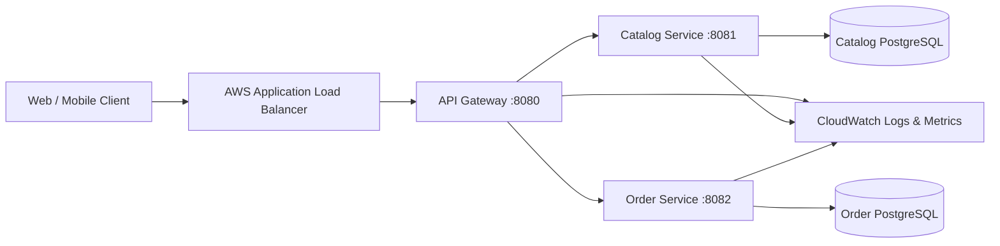

# E-Commerce Order Management System (Microservices Architecture)

Resume-ready e-commerce microservices backend built with Java 25, Spring Boot 3.5, Spring Cloud, PostgreSQL, Docker, REST APIs, and an AWS deployment design.

## Architecture



Each service owns its data. The gateway is the only public application entry point and performs path-based routing; it is the natural place to add JWT authentication, rate limiting, correlation IDs, and request logging.

## Run locally

Requires Docker Desktop. Start the stack with:

```bash
docker compose up --build
```

The Compose stack currently uses one PostgreSQL container with two isolated logical databases. Before production, provision `order_db` as well (for example with an RDS initializer); each service still has separate tables, credentials, and a database boundary. For stricter production isolation, use a dedicated RDS instance/database per service.

## REST API through the gateway

| Method | Endpoint | Purpose |
| --- | --- | --- |
| `POST` | `/api/v1/products` | Create a product |
| `GET` | `/api/v1/products` | List products |
| `GET` | `/api/v1/products/{id}` | Get product |
| `POST` | `/api/v1/orders` | Create an order |
| `GET` | `/api/v1/orders` | List orders |

Create a product:

```bash
curl -X POST http://localhost:8080/api/v1/products -H "Content-Type: application/json" -d '{"name":"Mechanical Keyboard","price":99.99,"availableQuantity":25}'
```

Create an order:

```bash
curl -X POST http://localhost:8080/api/v1/orders -H "Content-Type: application/json" -d '{"customerId":"customer-101","productId":"PRODUCT_ID","quantity":1,"totalAmount":99.99}'
```

## AWS design

Deploy the three immutable Docker images to Amazon ECR and run them as ECS Fargate services in private subnets. Put an internet-facing ALB in public subnets and route traffic only to the gateway. Store application secrets in AWS Secrets Manager, use Amazon RDS for PostgreSQL, publish structured logs and health metrics to CloudWatch, and use IAM task roles with least privilege. Use multi-AZ RDS, ECS autoscaling, and CI/CD to build, test, scan, and promote images.

## Resume project entry

**E-Commerce Order Management System (Microservices Architecture)**  
*Java 25, Spring Boot 3.x, Spring Cloud (API Gateway, Eureka, Config Server), PostgreSQL, Docker, AWS (ECS/EKS, RDS, S3, ALB), REST APIs, Kafka/RabbitMQ*

- Designed and developed a microservices-based e-commerce platform, decomposing a monolith into independently deployable User, Product, Order, Payment, and Notification services.
- Implemented RESTful CRUD APIs with request validation, exception handling, and a layered Controller → Service → Repository architecture using DTOs.
- Built a centralized Spring Cloud Gateway for routing, load balancing, JWT authentication, authorization, and rate limiting across services.
- Integrated Eureka service discovery and Spring Cloud Config Server to remove hardcoded service URLs and manage environment-specific configuration.
- Applied a database-per-service pattern with PostgreSQL, Spring Data JPA, and Hibernate; containerized services with multi-stage Docker builds.
- Designed AWS deployment on ECS Fargate/EKS with ALB traffic distribution, autoscaling, Amazon RDS, VPC security groups, IAM task roles, ECR, S3, and CloudWatch monitoring.
- Used REST clients (WebClient/Feign) for synchronous calls and Kafka/RabbitMQ for asynchronous order-status and notification events.
- Added Resilience4j circuit breakers, JUnit 5/Mockito/Testcontainers tests, and CI/CD automation using GitHub Actions or Jenkins for test, image-push, and deployment stages.
